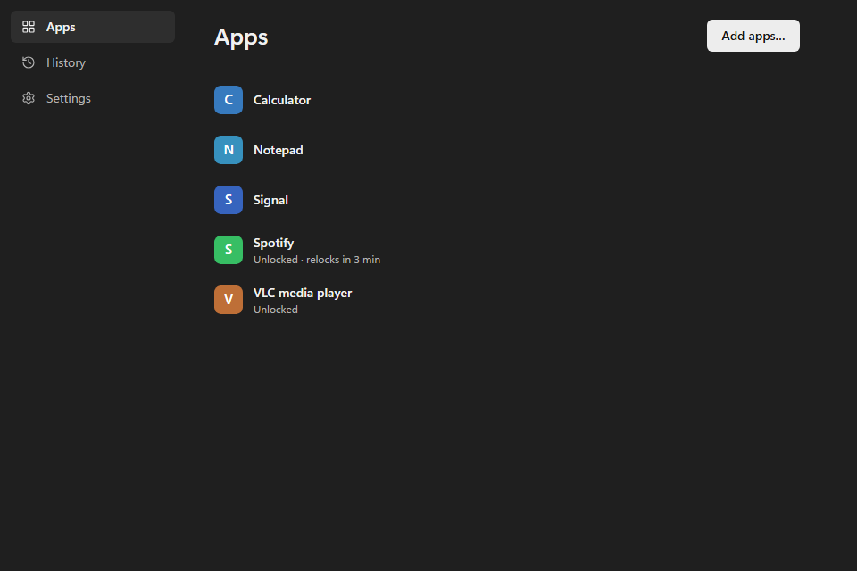
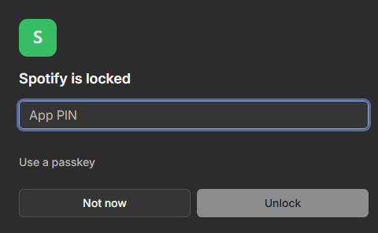
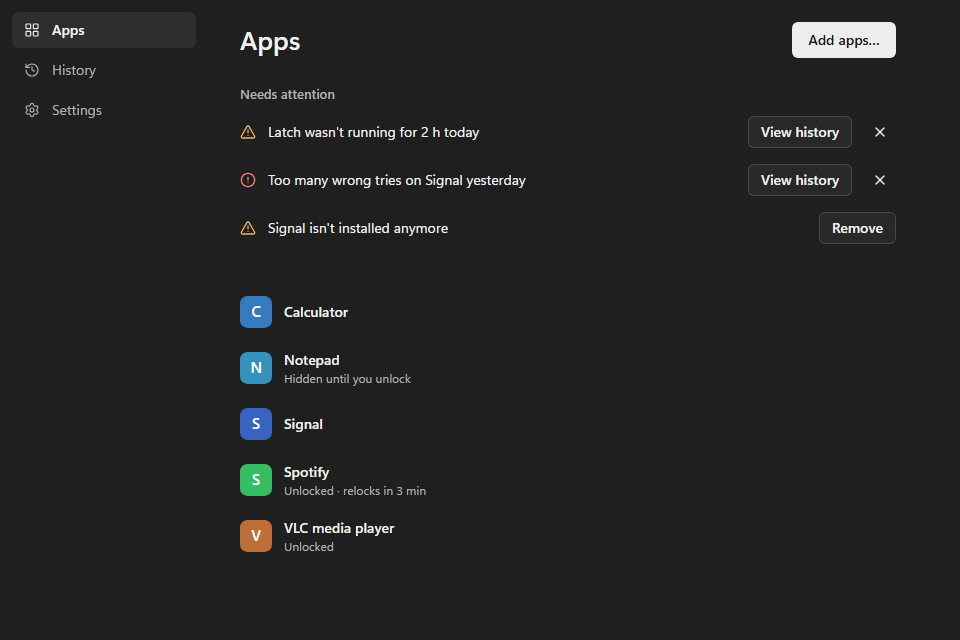
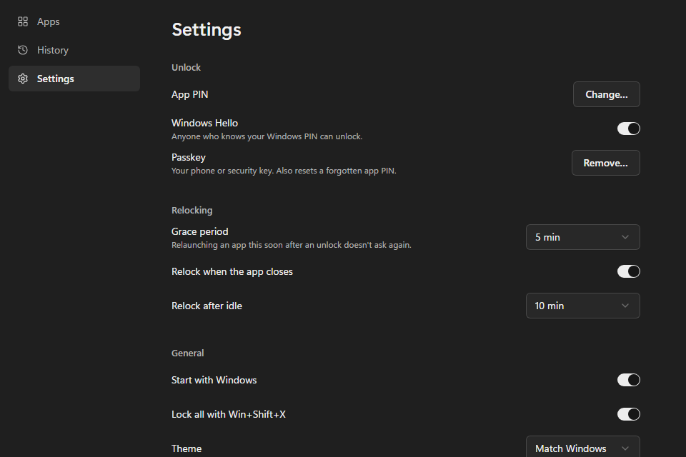

<div align="center">


# Latch

### Lock your apps, not your PC.

A quiet app locker for Windows. The apps you choose hide the moment they open and come back only after your app PIN,
Windows Hello or a passkey. Hand someone your laptop and they can browse the web without reading your chats.

[](../../releases/latest)
[](https://github.com/Alexciao/latch/actions/workflows/ci.yml)
[](#install)
[](LICENSE)

[**Download**](../../releases/latest) · [Features](#features) · [What it doesn't do](#what-latch-doesnt-do) · [Install](#install) · [Build from source](#build-from-source)

<br>



</div>

## Why Latch

- **Fast, so locked apps don't show.** Latch sees a locked app's window the moment Windows shows it and hides it. A
  cover with the app's icon and a *Locked* title bar is in its spot within about a frame, and the pre-warmed unlock
  prompt paints about a tenth of a second after the app opens.
- **Unlock the way you already do.** Use a 6–12 digit app PIN, Windows Hello (face, fingerprint or Windows PIN), or a
  passkey on your phone or a security key. A passkey also resets a forgotten PIN.
- **Calm, not naggy.** A grace period means relaunching an app you just unlocked doesn't ask again. Apps relock when they
  close (tray apps like WhatsApp and Discord included), after you've been idle, or all at once with **Win+Shift+X**.
- **Honest about its limits.** Latch is for keeping casual eyes out, not for stopping an attacker. If someone closes
  Latch to get around it, History shows the gap the next time it starts.

<p align="center">
  
  
  
  
</p>

## Features

**Lock any app.** Pick from the apps installed on your PC, or browse to any program. Classic desktop apps match by
path, or by the same signed publisher and product, so an update that moves the exe stays locked. Microsoft Store and
other packaged apps, Calculator and Notepad included, match by package.

**Three ways to unlock.**
- *App PIN*: 6 to 12 digits, separate from your Windows PIN. It's stored only as a salted PBKDF2-SHA256 hash
  (600,000 iterations) and checked in constant time.
- *Windows Hello*: optional. Anyone who knows your Windows PIN can then unlock, and Latch says so when you turn it on.
- *Passkey*: optional, on your phone (by QR code) or a security key, never on the PC itself. Latch is its own WebAuthn
  relying party and verifies every signature. A passkey also works during a PIN lockout and clears it.

**Relocking.** Grace period: off, 1, 5, 15 or 60 minutes. Relock when the app closes. Relock after 5 to 60 minutes
idle. Lock everything now with Win+Shift+X or from the tray.

**Wrong guesses slow down.** After four wrong PINs in a row, Latch waits 30 seconds, and the wait doubles with each
further miss, up to 15 minutes.

**History.** Every unlock (and how), wrong try, cancelled prompt and lockout. Gaps when Latch wasn't running show up
there and under *Needs attention*. A 60-second heartbeat tells a clean quit apart from Latch being ended.

**Latch locks itself too.** Opening Latch, quitting it, changing the PIN, turning off Windows Hello or stopping it from
starting with Windows all ask you to unlock first.

**Feels like Windows.** A tray app with Mica on Windows 11 and light and dark themes that follow Windows. The cover
uses Windows 11 caption metrics, and while Windows Hello is open the prompt shrinks to a small card just above its
dialog.

## What Latch doesn't do

Latch stops a non-technical person using your signed-in Windows account. It is a normal per-user app: a visible tray
icon, a normal uninstall, no service, no admin rights, no code injected into other apps and no self-protection. So it
**can't** stop someone who:

- ends Latch in Task Manager (History will show the gap),
- edits the registry or your user files, or
- boots another operating system or reads the disk directly.

Locked windows are hidden, not covered with an overlay: an overlay would still leak through Alt+Tab, taskbar
thumbnails and screen sharing, and keystrokes would still reach the app. The reasoning behind this and every other
choice is in [DECISIONS.md](DECISIONS.md).

## Install

1. Download **`LatchApp-win-Setup.exe`** from the [latest release](../../releases/latest) and run it. It installs for
   your user only, with no admin prompt, and fetches the WebView2 runtime if it's missing. Windows 10 (version 2004 or
   later) or Windows 11, x64.
2. The installer isn't code-signed yet, so SmartScreen may say *"Windows protected your PC"*. Click **More info → Run
   anyway**.
3. First run walks you through three steps: set your app PIN, optionally turn on Windows Hello or add a passkey, and
   pick the apps to lock. Latch then lives in the tray and starts with Windows.

The app lives in `%LocalAppData%\LatchApp`. Your settings, PIN hash, history and log live apart from it in
`%LocalAppData%\Latch`, so reinstalling keeps them. Delete that folder to remove everything.

## Build from source

You need the [.NET 10 SDK](https://dotnet.microsoft.com/download) (pinned in `global.json`) and
[Node.js](https://nodejs.org) 24 with Corepack, which fetches the pinned pnpm by itself.

```powershell
git clone https://github.com/Alexciao/latch
cd latch
pwsh ./build.ps1          # UI, contract check, tests, self-contained publish and the installer
pwsh ./build.ps1 -NoPack  # the same, without the installer
```

The installer lands in `artifacts/releases`. Every push to `main` also builds one in CI, attached to the run as
`latch-installer`.

### Working on the UI

The UI runs in a browser against a mock backend that implements the same contract as the real host:

```powershell
corepack pnpm --dir web install
corepack pnpm --dir web dev   # http://localhost:5173
```

URL flags show each state: `?page=history`, `?page=settings`, `?state=fresh` (first run), `?state=attention`,
`?state=empty`, `?state=long` (worst-case data), and `prompt.html?mock=app|hello|lockout|latch` for the unlock prompt.
To run a second copy of the real app with its own data, set `LATCH_DATA_DIR` to a scratch folder.

### Releasing

Set the new `<Version>` in `Directory.Build.props`, commit, then tag and push:

```powershell
git tag v0.2.0
git push origin main v0.2.0
```

The [release workflow](.github/workflows/release.yml) checks that the tag matches the version, builds, tests and
packages Latch, and publishes a GitHub release with the installer and the full Velopack set. A tag with a hyphen
(`v0.2.0-beta.1`) becomes a prerelease. Notes come from `docs/release-notes/v<version>.md` if it exists, otherwise
GitHub generates them from the commits.

## How it works

```
 Latch.Host (WPF in code, WebView2)  ── tray, window watcher, covers, prompts, Windows Hello, passkeys, hotkey
        │  SetWinEventHook (out of context) → hide with ShowWindowAsync → cover → pre-warmed prompt
        │  typed RPC · one small state snapshot pushed on every change
 Latch.Core (plain net10.0, no UI)  ── lock engine, rule matching, PIN, lockout, passkey verification,
        │                               settings, secrets, history, heartbeat
 web/ (React 19, TypeScript, Vite, Tailwind, shadcn/ui)  ── main window and unlock prompt
```

All decisions live in `Latch.Core`, which is UI-free and unit-tested. The host is only Windows glue, and the web UI only
renders. One contract written in C# generates `web/src/contract.gen.ts`, and the build fails if it's stale.

| Doc | What's in it |
|---|---|
| [DECISIONS.md](DECISIONS.md) | Every design decision with its reason, measured results labelled `[E]` |
| [TECH-PHILOSOPHY.md](TECH-PHILOSOPHY.md) | How the app is built: thin host, fat core, one contract |
| [UI-PHILOSOPHY.md](UI-PHILOSOPHY.md) | What goes on screen and how it's said |
| [spike/](spike) | The throwaway experiment that measured hook latency and WebView2 start-up before any real code |

## License

[MIT](LICENSE)
